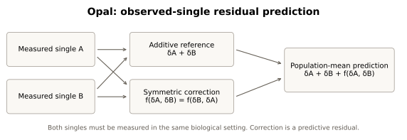
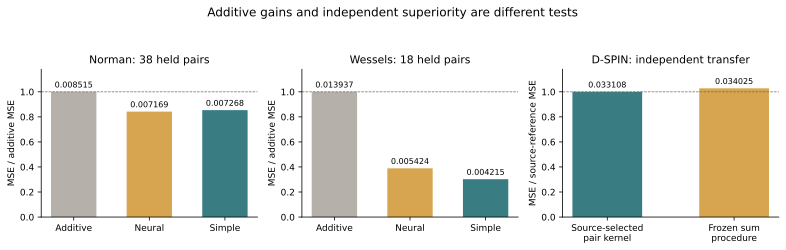

<div align="center">
  
  <h1>Opal</h1>
  <p>Observed-single combinatorial response prediction</p>
</div>

<div align="center">
  <a href="https://thetinyintelligencelab.vercel.app/"></a>
  
  <a href="paper/main.pdf"></a>
  <a href="LICENSE"></a>
</div>

<p align="center">
  <a href="#2-model-downloads">Models</a> &middot;
  <a href="#3-evaluation-results">Evaluation</a> &middot;
  <a href="#5-quick-start">Quick start</a> &middot;
  <a href="#8-license">License</a> &middot;
  <a href="#9-citation">Citation</a>
</p>

<p align="center"><a href="paper/main.pdf">Read the preprint draft</a></p>

Opal is The Tiny Intelligence Lab's research codebase for predicting biological responses to intervention pairs. The current **0.1.3.dev0 research snapshot** includes a trained double-CRISPRi growth predictor for K562 and Jurkat, alongside the preserved expression models and evaluation framework. The private 0.1.2 release and expression preprint draft remain historical snapshots.

The growth predictor improves on calibrated main effects within its training screen, but **its frozen predictions failed external superiority testing**. The completed [plan](plan.md), [research report](docs/model_development_20261020.md) and [external results](results/fitness-external-20261020/) record that limit. No frontier-performance or independently validated transfer claim is established.

## 1. Introduction

Opal studies what measured single perturbations and other observed pairs can tell us about an unmeasured combination. Its expression models predict population-mean responses from matched singles and controls using an additive reference plus a symmetric correction:

```text
predicted pair effect = measured effect A + measured effect B + correction(A, B)
correction(A, B) = correction(B, A)
```



The newer growth model predicts measured double-CRISPRi gamma using observed single growth, a calibrated gene-main-effect reference and symmetric low-rank residual completion. Gamma is control-centered log2 enrichment per population doubling. This functional endpoint has much denser pair supervision than the expression experiments; success on growth does not establish improved expression prediction.

The codebase retains neural heads, regression, residual kernels and explicit simple references. Model selection follows matched information access and locked evaluations. [Earlier scientific and engineering work](docs/engineering_record_20261015.md) remains preserved, while [plan.md](plan.md) is the sole authoritative forward plan.

This is independent research by **Arjun Vijay Prakash** at [The Tiny Intelligence Lab](https://thetinyintelligencelab.vercel.app/). AI assistance and author responsibility are disclosed in the manuscript.

## 2. Model downloads

The current growth assets remain local under the source-data terms; they are not included in the package or offered as a new public download. The historical private 0.1.2 release and its reference models remain unchanged.

| Model | Inputs and output | Evidence and availability |
| --- | --- | --- |
| Growth completion, K562 / Jurkat | Supported gene identities, original measured singles and other training pairs; predicts double-CRISPRi gamma | Retained independent-context models; within-source gains, failed K562 external superiority; local assets |
| Hierarchical expression composition | Matched single-expression effects; predicts population-mean double effects | Closed failed hypothesis against matched affine/kernel references; local assets |
| Norman residual kernel | Registered K562 single-effect profiles; fixed-gene population-mean pair effect | Historical exploratory reference; private release |
| EmeraldBay contextual kernel | Exact-dose singles and controls in supported contexts | Historical chemical pilot; independent D-SPIN superiority gate failed; private release |

Growth inference combines the original observed-single/main-effect reference with the validation-selected completion checkpoint. It refuses unknown genes, genes without training support, identical-gene pairs and untrained contexts. It does not return calibrated biological prediction intervals.

The [historical model guide](docs/models.md), [first model series](docs/next_cycle/opal_model_series.md) and [second model series](docs/next_cycle/opal_model_series_v2.md) document the earlier APIs and checkpoints. Evaluation weights and all-development deployment refits have separate roles; later refits do not acquire new evaluation scores. Raw data, restricted weights and external embedding banks are excluded from Git and distributions.

## 3. Evaluation results

### Measured-growth pair completion

The Horlbeck screen supplies 81,466 eligible canonical pairs in both K562 and Jurkat. A locked canonical-pair split assigns 48,879 to training, 16,293 to validation and 16,294 to test, keeping every guide variant and orientation with its pair. Every query gene has training-pair support.

| Growth context | Calibrated main-effect MSE | Retained independent completion MSE | Joint shared/private MSE |
| --- | ---: | ---: | ---: |
| K562 | 0.00187049 | 0.00137593 | 0.00136626 |
| Jurkat | 0.00050049 | 0.00042630 | 0.00045576 |

Independent completion improves on main effects by **26.44% in K562 and 14.82% in Jurkat**. The joint shared/private candidate fails its stronger-reference promotion rule, so independent completion is retained. These are within-source missing-pair results among supported genes, not unseen-gene or independent-screen confirmation. [Frozen results and selections](results/fitness-20261020/) preserve every baseline and the failed sharing hypothesis.

### Independent K562 source transfer

The existing predictor was frozen before scoring untreated/DMSO growth from two external studies, comprising four cohorts with two infection replicates each. Strict novel pairs are absent from the entire original eligible bank. Training, validation and original-test overlaps are reported separately.

| External cohort | Strict novel pairs | Completion MSE | Frozen main-effect MSE | Original-single minimum MSE |
| --- | ---: | ---: | ---: | ---: |
| Environmental 1 | 130 | 0.0710602 | 0.0695619 | 0.0358322 |
| Environmental 2 | 130 | 0.0504016 | 0.0493793 | 0.0255072 |
| PARPi 2022 | 423 | 0.1060987 | 0.1048554 | 0.0670913 |
| PARPi 2023 | 411 | 0.1067118 | 0.1055719 | 0.0672618 |

**FAILED HYPOTHESIS for unchanged-model external superiority.** Completion has 1.08-2.15% higher MSE than frozen main effects; conditional gene-resampling intervals include zero, and original-single minimum performs better in every cohort. No retraining or external calibration occurred. These studies share laboratory lineage, so they do not establish independent-laboratory validation.

External measured singles give much stronger simple predictions than the original singles, consistent with substantial assay/reagent shift. That is an extra-information diagnostic, not an adapted Opal result. [The full report](docs/model_development_20261020.md#independent-external-reference-growth-validation) records source rights, endpoint compatibility, coverage filtering, replication, uncertainty and failure diagnosis; [the locked protocol and outputs](results/fitness-external-20261020/) preserve the evidence.

### Closed expression candidate

Hierarchical gene-local composition loses to inner-selected affine or kernel references on both sources and holdout protocols. The candidate is closed; adding capacity without compatible new pair evidence is not justified.

| Development source | Holdout | Composition MSE | Selected baseline MSE |
| --- | --- | ---: | ---: |
| Norman, 88 fitting pairs | Pair | 0.006213 | 0.006089 |
| Norman, 88 fitting pairs | Partner | 0.006343 | 0.006322 |
| Wessels, 110 fitting pairs | Pair | 0.008510 | 0.007115 |
| Wessels, 110 fitting pairs | Partner | 0.009281 | 0.009195 |

These are development folds on previously exposed sources, separate from the historical primary comparison below. [Composition results](results/composition-20261020/) retain the protocol, negative result and reproducibility records.

### Historical primary expression results

| Dataset | Held pairs | Additive MSE | Selected neural MSE | Selected simple-reference MSE |
| --- | ---: | ---: | ---: | ---: |
| Norman | 38 | 0.008515040 | 0.007169187 | 0.007268184, reduced-rank |
| Wessels | 18 | 0.013936912 | 0.005423558 | 0.004214949, global correction |



The Norman advantage over its selected reference is inconclusive, and Wessels favors the simpler global correction. The figure and table describe earlier expression experiments, not the new growth model. [The evidence guide](docs/evidence.md), [closed engineering record](docs/engineering_record_20261015.md) and [manuscript draft](paper/main.pdf) preserve the broader neural, kernel, dose, state and transfer comparisons. Scores across different endpoints and populations are not directly comparable.

## 4. Training and reproduction details

Current runs freeze source hashes, canonical-pair assignments, model selection and evaluation code before scoring. Training-only scalers and references prevent held-pair outcomes from entering fitting; validation selects configurations and checkpoints before the final test. External validation freezes existing assets and predictions without fitting to external outcomes.

The finite growth study took 18.72 seconds with one CPU worker and about 916 MiB peak working set. External preparation took 23.98 seconds; scoring took 0.57 seconds and about 246 MiB peak working set. The delivered code passed 410 tests, wheel/sdist builds, installed-wheel prediction replay and documentation checks. These verify computation, not biological usefulness.

After acquiring the hash-matched official source, a new registered growth run uses:

```sh
python tools/prepare_fitness.py --source /path/to/GSE116198_sgRNA_pair_phenotypes.txt.gz --output /path/to/new-prepared
python tools/study_fitness.py freeze --data /path/to/new-prepared --output /path/to/new-run
python tools/study_fitness.py run --output /path/to/new-run
python tools/export_fitness.py --run /path/to/new-run --output /path/to/new-model
```

No repeat run is required to use existing assets. [Acquisition and preparation receipts](results/fitness-20261020/) identify source bytes and terms; [the report](docs/model_development_20261020.md#independent-external-reference-growth-validation) includes external-evaluation commands. Earlier expression reproduction remains in [the reproduction guide](docs/reproduction.md). Source-specific data downloads and optional dependencies are required; biological studies are not installation checks.

## 5. Quick start

### Installation

Use Python 3.11 through 3.14. From this checkout:

```powershell
python -m venv .venv
.\.venv\Scripts\python.exe -m pip install --upgrade pip
.\.venv\Scripts\python.exe -m pip install -e ".[dev]"
.\.venv\Scripts\opal.exe --help
```

On Linux/macOS, use `.venv/bin/python` and `.venv/bin/opal`. The package's normal installation includes PyTorch and other declared dependencies; its download size isn't the size of the fitted kernel head.

### Synthetic execution check

```powershell
.\.venv\Scripts\opal.exe reproduce --config configs/experiments/release_quickstart.json --output results/synthetic/my-quickstart
.\.venv\Scripts\python.exe -m pytest -q
```

This runs two small synthetic scenarios and the software checks. It doesn't establish biological accuracy. Use a new output directory for each run; existing evidence isn't overwritten. `main.py` without arguments starts a much larger research workflow.

### Growth inference

With the retained local asset directory available:

```python
from opal.models.fitness_inference import FitnessPredictor

model = FitnessPredictor("C:/Users/USER/Desktop/opal-next-data-20261020/fitness-reference-model")
growth = model.predict([("AARS2", "AATF")], context="K562")
```

Use the exact source-assay contract and supported genes. External superiority failed, so these predictions do not establish transferable biological accuracy.

### Historical expression-reference inference

Extract the reference-model ZIP from the historical private release, then:

```python
from opal import load_model

model = load_model("models/norman-kernel")
prediction = model.predict("AHR", "KLF1")
effect, genes = prediction["effect"], prediction["genes"]
```

The output follows the manifest's fixed gene order and effect scale. EmeraldBay uses `model.predict(a, b, context=context)` with registered contexts and both measured singles available. Check support metadata before interpreting a query.

## 6. FAQ

**Why is the package called `opal-research`, but imports use `opal`?** Distribution names and Python import names serve different purposes. Setuptools maps `src/` to the installed `opal` package.

**Which model is retained?** Independent-context growth completion is retained for the original K562/Jurkat assay. Its within-source gains survive the locked test; its unchanged K562 external-superiority hypothesis fails. The shared/private growth candidate and hierarchical expression-composition candidate are closed.

**What does the 0.1.2 release contain?** Historical code, comparative evidence and kernel references in a private GitHub release. The current source is 0.1.3.dev0; the new local growth assets are not part of that release. The expression preprint draft does not report the newer growth experiments.

**Does the model learn biological interactions?** The evidence does not establish transferable mechanistic interaction recovery. Residuals contain measurement error and shared distortion as well as potential pair-specific effects, so comparison with strong simple references remains essential.

**Can it predict new genes or arbitrary contexts?** The growth model requires genes supported by original pair training and one of its trained contexts. Earlier missing-single/state experiments do not establish general-purpose transfer.

## 7. Limitations

Within-source pair completion is easier than transfer across screens. Guide choice, effective knockdown, growth window, normalization and depletion floors can change the response even in K562. The external studies show substantial source mismatch; the matched-guide subset is too small to establish novel-pair transfer. Shared laboratory lineage also limits claims of biological independence.

The expression banks have limited pair supervision, repeated splits share data, and several context-transfer and uncertainty hypotheses failed. Conditional pair/gene intervals are not biological prediction intervals. Passing tests, exact replay and safe exports do not establish mechanisms, clinical usefulness or frontier performance.

Raw data and model assets remain local under source-specific terms. The Horlbeck author dataset is CC BY 4.0, but exact identity with the acquired GEO mirror remains unverified. Opal's code license does not resolve external dataset rights.

## 8. License

Original Opal code is [MIT](LICENSE). Dataset-derived Norman and EmeraldBay reference content retains CC BY 4.0 terms; [third-party notices](THIRD_PARTY_NOTICES.md) document attribution and exclusions. Template provenance and permission are recorded in the third-party notices. An Opal code license doesn't relicense external sources or pretrained resources.

## 9. Citation

The preprint hasn't been submitted to arXiv. Until an identifier exists, don't cite a fabricated arXiv number or describe it as peer reviewed. The following citation identifies the current development snapshot:

```bibtex
@software{prakash_opal_2026,
  author = {Prakash, Arjun Vijay},
  title = {Opal: observed-single combinatorial response prediction},
  year = {2026},
  version = {0.1.3.dev0},
  url = {https://github.com/TheTinyIntelLab/opal}
}
```

[CITATION.cff](CITATION.cff) supplies structured software metadata. Add the actual arXiv identifier and archival DOI only after they're assigned.

## 10. Contact

Read [The Tiny Intelligence Lab](https://thetinyintelligencelab.vercel.app/) for project updates. Once the repository is public, use [GitHub issues](https://github.com/TheTinyIntelLab/opal/issues) for reproducible code or evidence problems.
