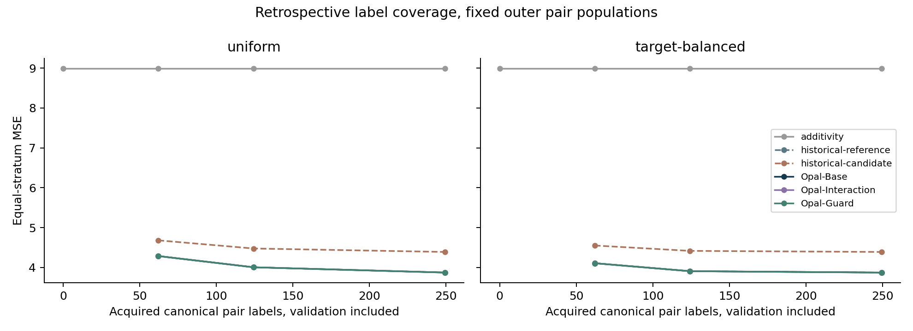
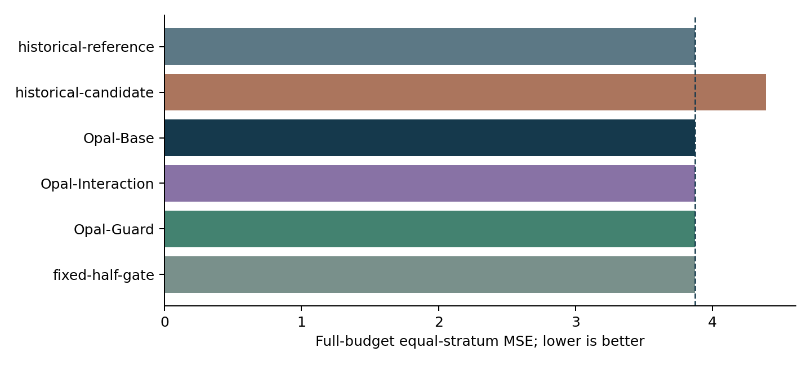

# Trainable Opal model series

Opal-Base is the recommended source-specific reference. Opal-Interaction and Opal-Guard are working experimental variants with actual learned parameters, but their small retrospective Combi-seq gains don't justify replacing Base. These checkpoints support measured singles in the declared assay and source stratum. They don't support unseen singles, dose/state extrapolation or universal cross-assay weights.

## Models and measured results

| Model or control | Combi-seq full-budget MSE | Status |
| --- | ---: | --- |
| No change | 5.713889 | Zero-label control |
| Observed-single additivity | 8.993460 | Zero-label control |
| Strongest historical reference / Opal-Base | 3.872700 | Recommended reference |
| Historical pair-kernel candidate | 4.388534 | Preserved unfavorable comparison |
| Opal-Interaction | 3.871518 | Experimental; 0.030506% relative reduction from Base |
| Opal-Guard | 3.871571 | Experimental; 0.029157% relative reduction from Base |
| Fixed half-gate ablation | 3.871665 | Diagnostic constant mixture |

These are gene-averaged errors on the unchanged singles-derived 512-gene panel, equally weighted over 374 canonical pairs in each reported run and then over the three runs. The historical reference and candidate replay exactly, including their selections and shuffle predictions. Every canonical pair remains in the same outer fold across runs, aliases and reversed component order. Query controls/singles are allowed; held pair outcomes aren't fitting inputs. No original biological gate passes.

Base selects the existing additive, shared-offset, global, summed-single or centered component-additive reference inside acquired development folds. Each full-budget Combi-seq fit selected the component-additive family. Its checkpoint contains actual coefficients, intercept, component identities and preprocessing. Unsupported components receive zero identity coefficients, retaining the fitted shared correction.

Interaction freezes this fitted expert and learns a residual with a shared two-layer tanh encoder of widths 64 and 16. The encoder outputs are multiplied elementwise and projected to the 512 genes. Input mean/scale and learned parameters use development only; the branch uses weighted MSE, two fixed penalties, one seed and a 60-epoch cap. Selection chooses an epoch using acquired inner-validation labels, followed by a refit for that fixed epoch. Pair reversal is invariant in reference arithmetic, preprocessing and the branch.

Guard uses three grouped out-of-fold expert fits, each with nested development-only selection, to learn a regularized affine sigmoid mixture. Its inputs are endpoint development degrees, distance to training single profiles and source-context membership. Gate scaling for selection uses gate-training rows, then the final gate is refitted on all OOF rows. A zero-degree component or absent source context forces Base fallback. The gate is a mixture weight, not a probability of correctness or calibrated uncertainty. Missing assay, gene, scale or measured-reference provenance causes refusal.

The optimization budgets differ. Base searches the thirteen reference entries of the historical sixteen-entry menu. Interaction adds two penalty attempts and development-only epoch selection. Guard adds three nested expert cross-fits and two gate attempts capped at 120 epochs. The runner shares the identical final Base and Interaction experts across variants instead of fitting redundant copies. Complete epoch histories, selection comparisons and cross-fit pair membership remain in the local fit receipts and checkpoint JSON.

## Retrospective label coverage

| Acquisition order | Budget | Acquired development pairs by outer fold | Base MSE | Interaction MSE | Guard MSE |
| --- | --- | --- | ---: | ---: | ---: |
| Uniform | 25% | 62 / 62 / 62 | 4.285726 | 4.286661 | 4.285769 |
| Uniform | 50% | 124 / 124 / 125 | 4.004385 | 4.004442 | 4.003942 |
| Target-balanced | 25% | 62 / 62 / 62 | 4.106214 | 4.107159 | 4.106312 |
| Target-balanced | 50% | 124 / 124 / 125 | 3.906318 | 3.906131 | 3.905749 |
| Either | 100% | 249 / 249 / 250 | 3.872700 | 3.871518 | 3.871571 |

Rows average sampling seeds 11, 29 and 47 descriptively. The full measured panel has 374 pairs; each outer test contains 124 or 125 and never changes with budget. Budget counts include every unique identity used in fitting, inner validation, stopping and Guard cross-fitting. At zero labels only no-change and additivity are available; all pair-supervised methods are explicitly unavailable. No positive-budget condition was omitted in this source.

Uniform acquisition permutes sorted canonical identities with the declared seed. Target balancing greedily minimizes the maximum acquired endpoint degree, then their degree sum, then a fixed seeded identity rank, updating both degrees after each addition. Both use nested prefixes and inspect identities only. The coverage rules favor balanced acquisition at these intermediate budgets, while added nonlinear complexity changes error little. Marginal MSE change per added label is saved descriptively; this isn't validated active learning or prospective wet-lab savings.





The reference and Base curves overlap exactly. Controls include the historical pair candidate, three alignment-shuffle seeds, a zero interaction branch, an always-on branch and a fixed half-gate. Pair errors, all strata, all budget conditions and source-qualified contrasts remain in [the result directory](../../results/opal_model_series_v1/combi-seq/). Neither the tiny full-budget gains nor the shuffled contrast identifies biological interactions, a noise ceiling, independent cultures or validated uncertainty.

## Checkpoints and inference

The local checkpoint root is `E:/opal-model-series-20261010/fits/`. [The full-budget manifest](../../results/opal_model_series_v1/combi-seq/checkpoint_manifest.json) and [the all-budget manifest](../../results/opal_model_series_v1/combi-seq/all_budget_checkpoint_manifest.json) record exact paths, source, run, split, selected expert, hashes and replay errors. Each model has `model.json`, `parameters.npz` and `integrity.json`. Numerical arrays load with `allow_pickle=False`; no executable model deserialization is used. The JSON binds architecture, genes, units, transforms, source/input hashes, fitting identities, seed, software version and selection lineage. All checkpoints are frozen outer-evaluation models; there is no all-development deployment refit disguised as an evaluation checkpoint.

Install the locally built wheel, then use an explicitly source-compatible measured-single bundle:

```python
import json
import numpy as np
from opal import load_model

model = load_model(checkpoint_path)
contract = json.load(open(contract_path, encoding="utf-8"))
with np.load(query_path, allow_pickle=False) as data:
    query = {key: data[key] for key in data.files}
result = model.predict(query, contract)
# result includes predictions, pair_ids, support, status, gate and provenance.
```

The query NPZ has only `singles` with shape batch × 2 × genes, `pair_ids` as canonical JSON strings, and `culture_ids` as declared source-stratum labels. It must not contain responses. A development NPZ adds `responses` and optionally grouped `partitions`. The contract supplies exact ordered genes, source, assay, units, reference provenance and split lineage; fitting also declares globally held and acquired pair IDs. Canonical access declarations refuse unresolved aliases or reversed IDs, while query identities are resolved and reordered with their single profiles.

The actual Combi-seq example is under `E:/opal-model-series-20261010/example/`, with evaluator outcomes separate from query inputs. Run these commands outside the checkout with the installed package:

```powershell
python -m opal.cli series-train --model Opal-Guard --inputs E:/opal-model-series-20261010/example/development.npz --contract E:/opal-model-series-20261010/example/contract.json --config <frozen-series-config.json> --menu <historical-menu.json> --output <new-checkpoint-directory>
python -m opal.cli series-predict --checkpoint <checkpoint-directory> --inputs E:/opal-model-series-20261010/example/query.npz --contract E:/opal-model-series-20261010/example/contract.json --output <new-prediction-directory>
python -m opal.cli series-evaluate --freeze <prediction-directory> --inputs E:/opal-model-series-20261010/example/query.npz --contract E:/opal-model-series-20261010/example/contract.json --outcomes E:/opal-model-series-20261010/example/outcomes.npz --output <new-score.json>
```

`MODEL_REGISTRY` in `opal.series` exposes the three classes. Each provides `fit`, `predict`, `save` and `load`. Existing `opal.load_model` also restores this format. The prediction command freezes arrays and input/contract hashes before scoring; evaluation rejects changed genes, units, inputs or prediction bytes. Reusing a prediction directory is refused.

## Source terms and limits

The first actual training source is exposed Combi-seq GSE174695 on nominal chemical identities and aggregate-read log2 library-total-10000 changes. Exact constituent dose/vehicle compatibility and culture initiation remain unresolved. The 512-gene endpoint is reference-derived; source-wide gene results remain in their separate historical processing diagnostic. Genetic and chemical identities and incompatible assay losses are never pooled.

New weights, reference arrays and per-profile predictions remain local. No weight assets are bundled into the wheel or uploaded, and derivative redistribution terms still require review before publication. The published private GitHub v0.1.2 assets remain unchanged. This local development build isn't a new public release.

The bounded PertSpectra attempt has separate [access/exposure records](../../results/opal_model_series_v1/pertspectra/). Its deposited guide mixtures define a label-conditional target, not exact matched-guide causal effects. SampleIndex and TNF context don't establish independent cultures. Preparation and any eligible model execution must retain their own source/scale contract; the Combi-seq weights do not claim transfer.

The [completed extension](pertspectra_model_series.md) trained and evaluated separate 108-pair TNF-positive and 52-pair TNF-negative banks. Both nonlinear variants lose to Base, and no-change beats every fitted variant on TNF-negative. Its 648 conditions and 864 source-specific checkpoints replay exactly; small-budget unavailable cases and the unfavorable source sample-label transport diagnostic remain visible. Individual [Base](../model_cards/opal-base.md), [Interaction](../model_cards/opal-interaction.md) and [Guard](../model_cards/opal-guard.md) cards summarize all three source contracts.

Primary motivation remains [strong simple comparisons](https://www.nature.com/articles/s41592-025-02772-6), [nested-selection bias](https://www.jmlr.org/papers/v11/cawley10a.html) and [biological pseudoreplication](https://pmc.ncbi.nlm.nih.gov/articles/PMC8479118/). These sources motivate controls, not a certificate that Opal wins. The [PertSpectra paper](https://psb.stanford.edu/psb-online/proceedings/psb26/chang_s.pdf) motivates a public unseen-combination task, but its performance and filtered population aren't copied into this benchmark.
