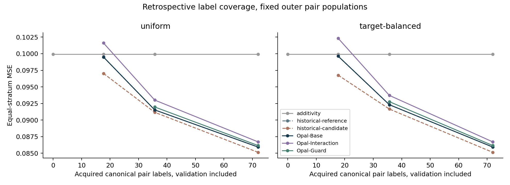
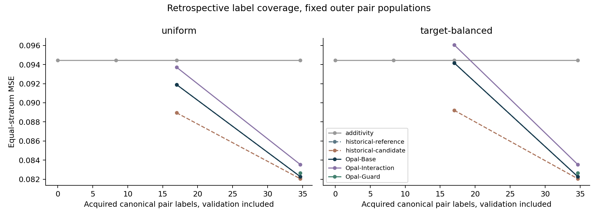

# PertSpectra source-specific model execution

The extension trained all three models on separate TNF-positive and TNF-negative banks. Base beats the new nonlinear variants in both contexts, and no-change beats every fitted method on the TNF-negative endpoint. The weights and recommendations are source-specific; neither a public dataset nor a SampleIndex label supplies independent-culture confirmation.

## Assay and molecular assignments

The public [in-house object](https://pert-spectra.s3.amazonaws.com/data/inhouse.h5ad) is 3,142,132,144 bytes with full SHA-256 `7b72d474be90d3e236e9b4d7dce3fdf9806e5329f84f3eaa973ec605f52ebd12`. The multipart ETag was used for object consistency, not as a file hash. The file was assembled from checked HTTP ranges and hashed before expression decoding. Its X and counts layer use CSC storage; the verified counts layer contains finite nonnegative integer values over 13,901 deposited genes. Bounded 128-gene column processing and sparse label membership produced dense aggregates only, with sampled preparation RSS about 340 MB. No cell-by-gene matrix was densified.

For each SampleIndex/TNF stratum, normalize each positive-library deposited count profile to 10,000 over the retained source genes, average normalized counts within its deposited target label, then apply log2(1+x). Subtract that stratum's control mean for single and pair effects. Each context's 512-gene endpoint uses variation of unique reference single labels across its four strata with lexical ties; pair responses never select genes. This is a new declared assay contract, with upstream gene filtering/processing dependence, rather than a reproduction of the paper's model endpoint.

Controls have one or two `CTRL00*` target calls. A single has one real target with an optional control call. A pair has two distinct real targets, globally grouped in canonical order. Fixed rules exclude nan/ambiguous/intergenic calls, mismatched guide/target assignment lengths and self-pairs. There are 25,871 ambiguous/intergenic rows and 2,097 self-pair rows excluded before reference-supported panel construction. Require at least ten cells for controls, singles and pair conditions; retain only complete canonical panels across all four source labels in the same TNF context. Cell counts and deposited guide mixtures are preserved in [support and exclusions](../../results/opal_model_series_v1/pertspectra/access-v4/support_and_exclusions.json).

The target is explicitly a gene-label-conditional average across the deposited mixtures. Literal single calls and gene/control calls may have different guide burdens, and single/pair mixtures need not have identical guide distributions. They do not identify an exact matched-guide causal effect. [Author code](https://github.com/insitro/PertSpectra/tree/main/data/inhouse) uses gene-derived condition labels; source hashes and the preprocessing audit are saved. Opal doesn't use expression-derived archetypes, clusters, embeddings, StringDB or pretrained weights.

The authors' pooled condition/context minimum-50 filter gives exactly 65,648 rows from the 73,015 deposited observations, as confirmed by [metadata-only reconciliation](../../results/opal_model_series_v1/pertspectra/paper_cell_count_reconciliation.json). That filter retains categories excluded by Opal and doesn't enforce Opal's per-stratum references. Opal's complete populations are consequently different: 108 canonical pairs in TNF-positive and 52 in TNF-negative. Sample labels 3/5/6/7 and 1/2/4/8 remain source strata, without inferred culture initiation.

The initial resource refusal, interrupted partial download and CSR-only adapter failure remain preserved. A correction records that stale file-size observations led to interrupting the first transfer despite a retained partial file; it wasn't a proven server stall. The CSC repair changed access mechanics before expression values were decoded, preserving the predeclared scale, eligibility, endpoint and model menu. Prior observation metadata, adjacent uninterpreted expression bytes, author notebook outputs and published narratives are disclosed. These outcomes are now exposed and aren't fresh confirmation.

## Actual model results

| Model/control | TNF-positive MSE | TNF-negative MSE |
| --- | ---: | ---: |
| No change | 0.137007 | 0.075095 |
| Additivity | 0.099904 | 0.094443 |
| Opal-Base / selected reference | 0.085929 | 0.082279 |
| Historical pair-kernel family, fitted here | 0.085133 | 0.082056 |
| Opal-Interaction | 0.086707 | 0.083545 |
| Opal-Guard | 0.086159 | 0.082651 |
| Fixed half-gate | 0.086092 | 0.082591 |

Each column equally weights canonical pairs within a source sample and then its four samples, with source-specific genes and weights. Absolute losses aren't pooled across these contexts or compared with Combi-seq. The historical pair-kernel family has small descriptive gains over Base, while Interaction is worse by about 0.91% and 1.54%, and Guard by about 0.27% and 0.45%, in the two contexts. The learned gate doesn't beat the fixed half-gate here. Base is the series default for TNF-positive; no-change is the preferred control on TNF-negative, with all trainable variants experimental there.

Each context completes all 324 budget/order/seed/stratum/shuffle conditions on globally shared canonical outer folds. Uniform and target-balanced orders use nested identity-only prefixes at 0/25/50/100%; validation and cross-fitting labels count as acquired. Small budgets lack required support in some partitions. These are explicit unavailable records, and summaries never average only favorable available folds. Uniform acquisition gives lower intermediate-budget Base error on these panels, unlike the Combi-seq result. This is retrospective label coverage, not validated active learning or prospective assay savings.

Independent replay checks all 552 TNF-positive and 312 TNF-negative checkpoints against saved predictions, scores, input hashes, gene order, canonical holdouts, acquisition prefixes and Guard cross-fit access. Maximum prediction difference is zero. Each source has its own [positive](../../results/opal_model_series_v1/pertspectra/TNFA-positive/checkpoint_manifest.json) or [negative](../../results/opal_model_series_v1/pertspectra/TNFA-negative/checkpoint_manifest.json) manifest. Actual installed-wheel refits, batch prediction and scoring match the saved source checkpoints outside the checkout. The same architecture/interface doesn't imply cross-assay or TNF weight transfer.

## Source sample-label transport

The additional bounded diagnostic contains 24 full-budget fits, each leaving a SampleIndex out within its TNF context and globally excluding every query pair from the other three training samples. Query controls/singles are allowed; training transforms and selection consume only training labels, with equal training-stratum weighting.

| Diagnostic | TNF-positive MSE | TNF-negative MSE |
| --- | ---: | ---: |
| Additivity | 0.099904 | 0.094443 |
| Base | 0.100691 | 0.097187 |
| Interaction / Guard with declared Base fallback | 0.100691 | 0.097187 |

The query sample context is absent from fitting, so both nonlinear variants use their declared Base fallback rather than asserting unsupported context generalization. Base itself loses to additivity. The [report](../../results/opal_model_series_v1/pertspectra/sample-label-transport/report.json) retains all folds and source samples. This is transport across source sample labels, not independent culture confirmation or TNF-state transfer.

## Reproduction and limits

Run `tools/prepare_pertspectra_series.py` with a new source/access directory and local bank location, then `tools/run_external_model_series.py --preparation <prepared-directory>`. Use `tools/verify_external_model_series.py` for independent saved-bank/checkpoint replay and `tools/diagnose_pertspectra_transport.py` for the separate transport diagnostic. Preparation requires `h5py` from the data extras and refuses invalid counts, source identity changes and unsupported storage rather than silently converting a transformed array to counts.

Local banks, weights, guide-level source metadata and prediction arrays remain under `E:/opal-model-series-20261010/pertspectra-banks/` and ignored raw storage. Compact source scopes, hashes, selection evidence, exclusions, pair errors, strata, curves and manifests are reviewable under `results/opal_model_series_v1/pertspectra/`. No new weights are packaged or published. The [primary paper](https://psb.stanford.edu/psb-online/proceedings/psb26/chang_s.pdf) motivates an unseen-combination task; its model scores aren't copied into Opal, and these results establish neither biological interaction detection, a noise ceiling, validated uncertainty nor an original gate pass.
