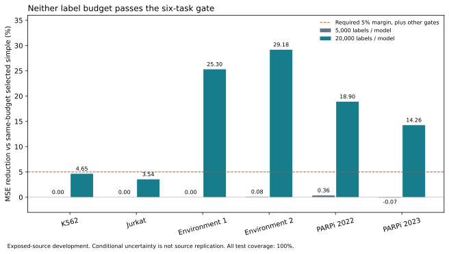

# Q3b pair-label-budget results

Neither registered budget qualifies. At 5,000 labels per fitted procedure, every task fails the screening gate. At 20,000, the four environmental/PARPi tasks pass, but Horlbeck K562 and Jurkat fail. Coverage is 100% in all twelve budget/task assessments, so these failures cannot be attributed to unsupported test genes or selective abstention. No budget is nominated, and no predictor is promoted.



## Registration and execution

The [frozen protocol](label_budget_protocol.md) reserves 4,000 training plus 1,000 validation labels, or 16,000 plus 4,000, per fold. Full-SHA pair ordering gives nested prefixes inside the original Q2 train/validation partitions. All six tasks retain all five original disjoint test blocks. The compared procedures receive identical measured singles, local pair labels, support and test populations. This remains exposed-source development; it neither confirms a new source nor isolates molecular interactions.

Registration `q3b-v3` has protocol SHA256 `ed17d936a2dd2670960fe222abef0a1c023751288a57dc9cc696e51fd59f1f9f`. Commit `c41e954` preceded real qualification and fitting. Thirty-five postfreeze prerequisites passed, including a complete mocked-native sixty-fit lifecycle and guards against test-label leakage, checkpoint tampering and partial scoring overwrite. Unfit v1/v2 registrations remain preserved: v1 underestimated native capacity in its proposed synthetic roster, and v2 lacked the stronger complete-lifecycle/scoring-custody qualification. Neither ran a real profile or biological fit.

The synthetic profile executed the maximum-budget native workload on 313 genes, where its default lookup dimension is largest, and separately bounded 600-gene reference/completion matrix costs. Its 32.1305255-second wall/31.203125-second CPU measurement forecast 2,409.7894125 seconds for the sixty-fit program, including a 25% margin. Exact synthetic replay passed before biological fitting.

The completed program fit 720 simple references, 240 aligned/shuffled completion models and 60 native 100-epoch models. All sixty validation-only family choices were saved and every selection/checkpoint hash bound before test scoring. The 5,000-label policy selected simple references in 19 folds and rank-eight completion in 11; the 20,000-label policy selected completion in all 30. Native was never selected. This compares frozen procedures with different compute and default capacity; it is not an optimized architectural ranking.

Fit wall time was 1,694.753098 seconds. Cumulative fitting, scoring and exact replay used **1,727.9082707 wall seconds, 1,718.53125 CPU seconds and 777,736,192 bytes peak process memory**, within the registered 7,200-second/2-GiB cap. The local output occupies 170,076,998 bytes, below the 256-MiB artifact cap. These measurements exclude the separately capped synthetic qualification and later read-only audit. Exact prediction-array and scientific-JSON replay passed without recipe or gate changes.

## Measured primary results

MSE is equal-pair error on mean infection targets. Gains compare the validation-selected family policy against the same-budget validation-selected twelve-reference simple policy. The intervals are 2,000-draw conditional endpoint-multiplicity gene sensitivity bounds for the paired MSE difference, not confidence intervals for independent biological sources.

| Budget/model | Task | Candidate MSE | Simple MSE | MSE reduction | Conditional difference interval | Gate |
| --- | --- | --- | --- | --- | --- | --- |
| 5,000 | K562 | .00214230490034 | .00214230490034 | 0% | [0, 0] | Fail |
| 5,000 | Jurkat | .000566348851689 | .000566348851689 | 0% | [0, 0] | Fail |
| 5,000 | Environment 1 | .000596234758704 | .000596234758704 | 0% | [0, 0] | Fail |
| 5,000 | Environment 2 | .000794420242610 | .000795091895294 | .084475% | [-.0000310152, .0000284102] | Fail |
| 5,000 | PARPi 2022 | .000360483581033 | .000361785919776 | .359975% | [-.00000707083, .00000448169] | Fail |
| 5,000 | PARPi 2023 | .000350131405918 | .000349887545467 | -.069697% | [-.00000272471, .00000313841] | Fail |
| 20,000 | K562 | .00181261671695 | .00190091928507 | 4.645256% | [-.000211981, .0000206325] | Fail |
| 20,000 | Jurkat | .000491902654667 | .000509930142454 | 3.535286% | [-.0000325978, -.00000501123] | Fail |
| 20,000 | Environment 1 | .000414206819977 | .000554512320009 | 25.302504% | [-.000183013, -.000105001] | Pass |
| 20,000 | Environment 2 | .000520815340558 | .000735378831362 | 29.177273% | [-.000278102, -.000160650] | Pass |
| 20,000 | PARPi 2022 | .000258189154328 | .000318356819205 | 18.899443% | [-.0000746749, -.0000478470] | Pass |
| 20,000 | PARPi 2023 | .000266572716766 | .000310903968091 | 14.258825% | [-.0000550095, -.0000344068] | Pass |

Every 5,000-label task misses the required 5% margin and negative upper bound. K562, Jurkat and PARPi 2023 also fail the all-fixed-reference veto; environment 2 and both PARPi tasks fail the requirement to avoid worsening either infection target. At 20,000, K562 misses the margin and its interval includes zero, while Jurkat misses the margin despite a negative interval. All other registered conditions pass for these two tasks. Every task at both budgets has sufficient controls and beats all three shuffled controls; that alone does not satisfy the stronger gate.

The later cohorts are related/overlapping assays, and their four passing rows do not constitute four independent confirmations. Smaller-budget weakness remains after complete training-gene support: the present frozen learning procedure needs more pair labels, different justified information, or a narrower deployment task than the universal low-label claim. These results do not distinguish statistical inefficiency, residual single-effect misspecification and genuine context-specific pair structure.

## Actual label accounting

Nominal budgets apply to each model, not to the union of five fitted procedures. Training and validation unions are disjoint within each task, but overlap substantially across its five folds. The complete cross-fitted program uses the following distinct pair-label unions, before singles, control constructs and infection measurements:

| Task | 5,000/model: training + validation union | 20,000/model: training + validation union |
| --- | --- | --- |
| K562 | 4,191 + 1,051 = 5,242 | 16,835 + 4,188 = 21,023 |
| Jurkat | 4,191 + 1,051 = 5,242 | 16,835 + 4,188 = 21,023 |
| Environment 1 | 4,268 + 1,058 = 5,326 | 16,976 + 4,253 = 21,229 |
| Environment 2 | 4,268 + 1,058 = 5,326 | 16,976 + 4,253 = 21,229 |
| PARPi 2022 | 4,228 + 1,055 = 5,283 | 16,870 + 4,199 = 21,069 |
| PARPi 2023 | 4,228 + 1,056 = 5,284 | 16,870 + 4,198 = 21,068 |

Every reserved validation label was supported and used. Measured singles are additionally available for 467 original-bank genes, 313 genes in each environmental task and 539/537 in PARPi; some original-bank genes never appear in eligible pairs. Shared controls, guides and infections are not independent biological replicates. These simulated label-access counts do not establish a physical experimental cost or prospective assay saving.

## Independent audit and reproducibility

The new [read-only audit tool](../../tools/audit_label_budget.py) independently recomputes full-SHA memberships, nested prefixes, all sixty actual validation prediction losses/argmins, native training-row permutations/checkpoint epochs, completion recipes, test predictions from saved checkpoints, all twelve primary/secondary metrics, full-population reference diagnostics, infection losses, all-reference/control vetoes, conditional bootstrap intervals and leave-one-gene effects. It checks every saved hash and selection-before-score timestamp, and reproduces the no-nominee decision and label unions. The audit runs only after both result and replay receipts exist, with a separate 600-second/2-GiB/1-GiB-reserve guard. It passed in 21.2218102 wall seconds, 20.171875 CPU seconds and 602,595,328 bytes peak process memory. Its exact receipt and code hash are in the [compact audit evidence](../../results/research-wave2-budget/q3b-v3/independent_audit.json).

Compact registration, prerequisite, qualification, selection, scoring, replay and audit records are retained under [the evidence directory](../../results/research-wave2-budget/q3b-v3/). Numerical states, arrays and full training-row lists remain local at `C:/Users/USER/Desktop/opal-wave2-20261021/q3b-v3`; compact selection projections retain each original record/checkpoint hash without redistributing those lists. The original unbounded audit completed its numerical checks but its first write failed on a NumPy Boolean; the final bounded audit fixes receipt serialization and independently repeats all checks. This was audit tooling, with no fitting, selection or scientific-result change.

```powershell
# Fresh execution requires a NEW output and its own prior freeze/verify receipts.
.venv/Scripts/python.exe tools/study_label_budget.py freeze --block-run C:/Users/USER/Desktop/opal-research-next-20261020/block-v2 --source C:/Users/USER/Desktop/opal-research-next-20261020/NAIAD --output <new-output>
.venv/Scripts/python.exe tools/study_label_budget.py verify --output <new-output>
.venv/Scripts/python.exe tools/study_label_budget.py profile --output <new-output>
# Run only if qualification.json passes, after preserving/committing registration.
.venv/Scripts/python.exe tools/study_label_budget.py fit --output <new-output>
.venv/Scripts/python.exe tools/study_label_budget.py score --output <new-output>
.venv/Scripts/python.exe tools/study_label_budget.py replay --output <new-output>
.venv/Scripts/python.exe tools/audit_label_budget.py --run C:/Users/USER/Desktop/opal-wave2-20261021/q3b-v3 --output <new-audit.json>
.venv/Scripts/python.exe tools/plot_label_budget_results.py --results C:/Users/USER/Desktop/opal-wave2-20261021/q3b-v3/results.json --output images/label_budget_results
```

The next scientific decision remains gated by the exact-reagent and flexible-singles evidence and a new prospectively justified residual test, rather than expanding architecture or retuning either failed budget. SPIDR response counts remain unopened.
