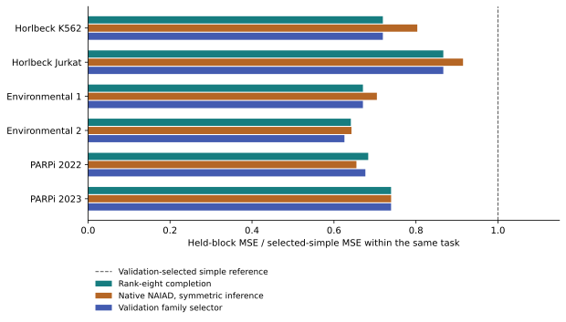

# Native comparator and validation-family results

Completed 21 October 2026. All thirty registered native NAIAD fits, all thirty validation-family choices, both scientific scoring runs and exact prediction/JSON replays completed. All sources were previously exposed development data. No predictor is promoted, and this is not independent confirmation.

## Measured comparison

The official pinned NAIAD implementation, with its fixed 100-epoch recipe and symmetric inference adaptation, beats the validation-selected twelve-reference simple policy in all six tasks. Every corresponding upper conditional gene bound is below zero, and no fixed simple reference has lower point-estimate MSE. Native NAIAD has lower MSE than rank-eight completion only in PARPi 2022. The other five native-versus-completion point differences favor completion; three of their conditional intervals include zero. These findings compare fixed recipes with different optimization and compute, not optimal architectures or the published paper's benchmark scores.

| Task | Selected-simple MSE | Rank-eight MSE | Native MSE | Validation selector MSE |
| --- | ---: | ---: | ---: | ---: |
| horlbeck_K562 | 0.00186564183562 | 0.0013418626514 | 0.00149857392955 | 0.0013418626514 |
| horlbeck_Jurkat | 0.000500916299832 | 0.000434156740486 | 0.000458256416279 | 0.000434156740486 |
| environment1 | 0.000545042900602 | 0.000365534151707 | 0.000384091800222 | 0.000365534151707 |
| environment2 | 0.000724876100593 | 0.000464753131115 | 0.000465881757133 | 0.000453404801034 |
| parp2022 | 0.000309550327768 | 0.000211597255522 | 0.000202686190352 | 0.00020944392621 |
| parp2023 | 0.000301616269371 | 0.000222981666182 | 0.000223018213434 | 0.000222981666182 |



Each loss uses the same canonical pairs and mean infection targets in that task. The 109,753 predictions are pair-context records across overlapping studies/tasks, not independent interactions or biological replicates. Absolute MSE is not pooled across sources.

| Task | Native gain versus rank eight (%) | Native-minus-rank-eight MSE conditional 95% bounds | Selector gain versus rank eight (%) | Selector-minus-rank-eight conditional bounds |
| --- | ---: | --- | ---: | --- |
| horlbeck_K562 | -11.678638 | [0.000108257544, 0.000213271968] | 0.000000 | [0, 0] |
| horlbeck_Jurkat | -5.550916 | [1.19593699e-05, 3.75712228e-05] | 0.000000 | [0, 0] |
| environment1 | -5.076858 | [-1.6138617e-06, 3.96595641e-05] | 0.000000 | [0, 0] |
| environment2 | -0.242844 | [-2.78222406e-05, 3.25143529e-05] | 2.441797 | [-3.27024947e-05, 7.17209306e-06] |
| parp2022 | 4.211333 | [-1.60741689e-05, -2.49222197e-06] | 1.017655 | [-4.1734775e-06, -1.42201828e-07] |
| parp2023 | -0.016390 | [-6.60138988e-06, 6.16960535e-06] | 0.000000 | [0, 0] |

Bounds use the frozen 2,000 endpoint-multiplicity gene draws, seed 20261022, with no empty draws. They describe conditional gene-panel sensitivity, not population biological confidence. Zero selector bounds in four tasks mean predictions are exactly identical to completion. All leave-one-gene-out values, secondary metrics, fixed-reference scores and fold results are retained in the machine-readable receipts.

## What validation selected

All thirty family choices were saved at `2026-10-21T02:01:16.142926+00:00`, before native test scoring. The frozen rule chose completion in 27 folds and native NAIAD in environment 2 folds 0/4 and parp2022 fold 3, with no simple-policy choices. It used actual symmetric native API predictions and the original checkpoints, without another epoch or threshold search. The selector reproduces completion exactly in four tasks, improves mean-target MSE by 2.441797% in environment 2 and 1.017655% in PARPi 2022, and improves both infection-target point estimates in those two tasks. The environment2 paired interval crosses zero; the PARPi2022 interval is below zero conditionally. Fold test-best regret is diagnostic only and does not replace the choices.

This selector was proposed after Q2 test exposure, then frozen before any native test score. Checkpoint and family selection reuse validation, so validation overfitting remains possible. No selector threshold, subgroup or native configuration was changed after these outcomes. Its small increments do not justify a new broad superiority claim or change any gate. Native NAIAD's 4.211333% PARPi2022 mean-target improvement over completion also improves both infection targets, but does not generalize across this roster.

## Execution and resource custody

The scientific fit roster charged 5,175.3938892 active wall seconds and 5,169.78125 CPU seconds. Fit plus scoring and exact replay charged 5,194.4098381 wall seconds and 5,187.890625 CPU seconds, with 602,046,464-byte recorded peak working set, within the registered 7,200-second/2-GiB cap. Family selection, scoring and replay charged 29.3550848 wall seconds and 28.890625 CPU seconds, with 531,910,656-byte peak working set, within 600 seconds. These are cumulative successful scientific-path charges, not total program cost.

Interrupted source-v2 and v6 attempts, the failed disk-guard retry and the stopped duplicate retry remain preserved. V6 ended after 26 complete fits; a new hash-bound sidecar amendment and 37 passing postfreeze tests preceded the four remaining fits. It retained all 26 checkpoints without loss-based selection, snapshotted original progress bytes and left the original native/family protocols and lifecycle bindings unchanged. The final selection manifest binds the sidecar and start receipt. Unknown uncheckpointed work remains unknown. The separately recorded disk failure used 218.5126765 seconds and stopped retry 264.4930237 seconds; qualification, other interruptions and uncheckpointed tails add further program cost.

The guard checks numerical boundaries and writable reserve rather than enforcing OS limits. Exact prediction arrays and scientific JSON replay passed for native and selector. Large states, fitting-row metadata and prediction arrays remain outside Git. Compact results, all 30 selected-model records, choices and lifecycle receipts are under [native evidence](../../results/research-reset-native-block/completed-v6/) and [family evidence](../../results/research-reset-family/completed-v1/). The [native comparability audit](native_comparability.md) explains the implementation adaptation and attribution limits.

The [independent review](native_independent_review.md) verified 723 hashes, all thirty validation choices, direct official test forwards and the primary intervals without discrepancy.

## Research consequence

Retain completion and native NAIAD as established-method baselines. Completion remains the economical default comparator for development; preserve the registered family policy and native's context-specific advantage without claiming a new architecture. More complex capacity is not justified by this result. The next discriminators are reagent/arm-matched aggregation, one fixed flexible singles-only reference, and declared pair-label budgets. A low-rank gene matrix can absorb nonlinear singles or persistent reagent effects, and native NAIAD changes its singles head too. Neither current comparison isolates molecular interaction learning.

SPIDR responses remain unopened. The authoritative [plan](../../plan.md) requires endpoint/rights qualification, exact guide-aware information parity, these development diagnostics and a frozen affordable procedure before a reserved-source test. A successful independent adapted procedure, followed by independent initiations or prospective assay decisions, would add evidence unavailable from these exposed sources.

## Reproduction

Actual numerical roots are `C:/Users/USER/Desktop/opal-research-next-20261020/block-v2`, `E:/opal-research-next-20261021/native-block-v6`, `E:/opal-research-next-20261021/native-tail-v1` and `E:/opal-research-next-20261021/family-v1`. The original pinned source checkout and licensed hash-matched banks are required. Commands that fit/select/score/replay refuse reuse; preserve this completed run and register new output roots for reproduction. Synthetic tests do not substitute for biological assets.

```powershell
.venv/Scripts/python.exe tools/resume_native_tail.py freeze --native-run E:/opal-research-next-20261021/native-block-v6 --output E:/opal-research-next-20261021/native-tail-v1
.venv/Scripts/python.exe tools/resume_native_tail.py verify --output E:/opal-research-next-20261021/native-tail-v1
.venv/Scripts/python.exe tools/resume_native_tail.py fit --output E:/opal-research-next-20261021/native-tail-v1
.venv/Scripts/python.exe tools/select_block_family.py select --output E:/opal-research-next-20261021/family-v1
.venv/Scripts/python.exe tools/resume_native_tail.py score --output E:/opal-research-next-20261021/native-tail-v1
.venv/Scripts/python.exe tools/resume_native_tail.py replay --output E:/opal-research-next-20261021/native-tail-v1
.venv/Scripts/python.exe tools/select_block_family.py score --output E:/opal-research-next-20261021/family-v1
.venv/Scripts/python.exe tools/select_block_family.py replay --output E:/opal-research-next-20261021/family-v1
```

The earlier [native registration](native_block_protocol.md), [recovery](native_resume_protocol.md), [tail amendment](native_tail_protocol.md) and [family protocol](block_family_protocol.md) describe original freeze/prerequisite order and exact scientific recipes. This command history does not overwrite the completed or interrupted attempts.

The exported figure is regenerated with `tools/plot_block_comparison.py --block-results <block-v2/results.json> --native-results <native-block-v6/results.json> --family-results <family-v1/results.json> --output <new-directory>`. Its provenance receipt binds the plotting code and three scientific result files; the plot shows point estimates, with uncertainty supplied in the table above.
